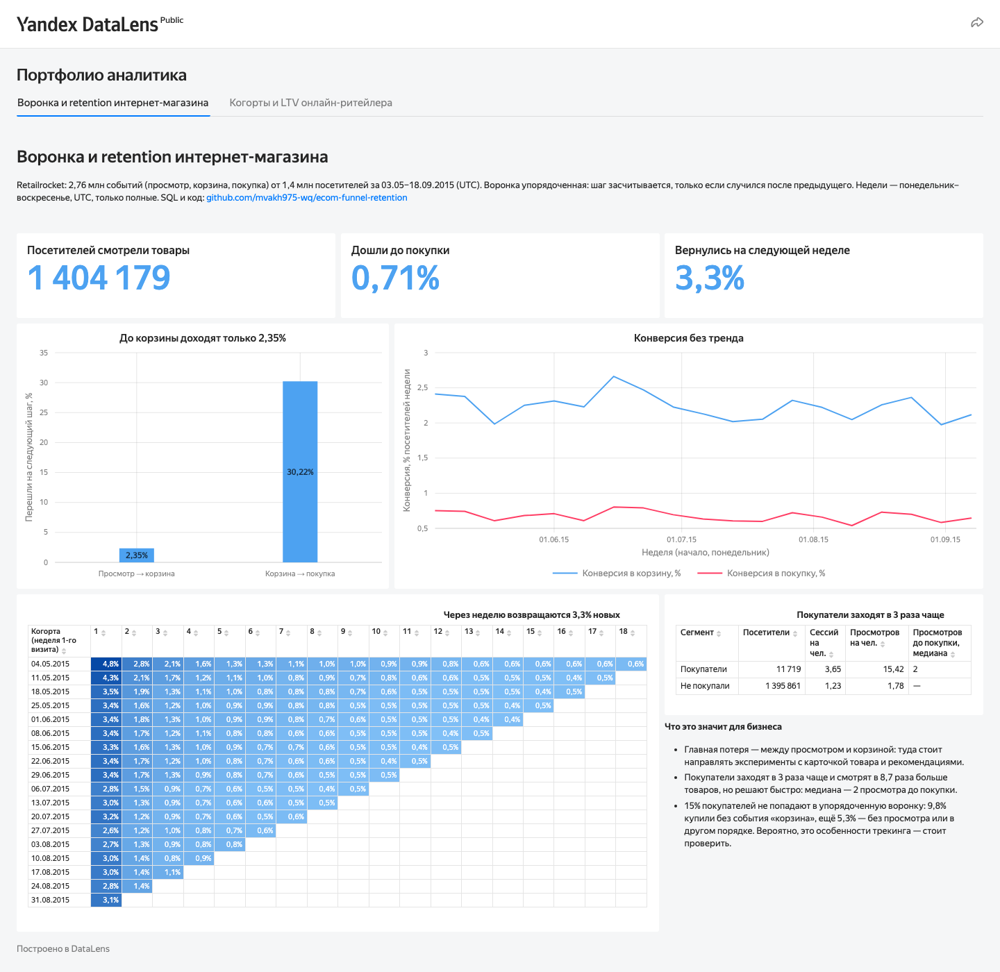

# Воронка и retention интернет-магазина

[](https://github.com/mvakh975-wq/ecom-funnel-retention/actions/workflows/ci.yml)

**Где интернет-магазин теряет посетителей на пути к покупке и возвращаются ли они?**
SQL-анализ 2,76 млн событий в PostgreSQL: собственная схема БД, упорядоченная воронка,
сессии, недельные когорты retention и публичный дашборд в Yandex DataLens.

**[→ Открыть дашборд в DataLens](https://datalens.yandex/07arbroepa4mj)**



## Главное

1. **До покупки доходят 0,71% посетителей.** Из 1 404 179 человек, смотревших товары,
   32 934 (2,35%) положили товар в корзину, 9 952 после этого купили. Главная потеря — между
   просмотром и корзиной: 97,7% уходят, не добавив ничего в корзину. Из корзины покупает каждый
   третий (30,2%).
2. **Конверсия стабильна весь период.** По неделям: 2,0–2,7% в корзину и 0,54–0,80% в покупку,
   без тренда — просадок, которые требовали бы разбора, нет.
3. **Посетители почти не возвращаются.** В среднем по когортам (взвешенно) на следующей неделе
   возвращаются 3,3% новых посетителей, через две недели — 1,6%, через месяц — 1,0%,
   через два — 0,7%. По отдельным когортам первая неделя — от 2,6% до 4,8%.
4. **Покупатели — вовлечённые посетители, решающие быстро.** У 11 719 покупателей в среднем
   3,65 сессии и 15,4 просмотра против 1,23 и 1,8 у остальных, но до первой покупки им хватает
   медианных 2 просмотров.
5. **15% покупателей не укладываются в воронку.** 9,8% купили без события «корзина», ещё 5,3% —
   без просмотра или с шагами в другом порядке. Вероятно, это особенности трекинга событий:
   прежде чем делать выводы о поведении, это стоит проверить с разработчиками.

## Данные

[Retailrocket recommender system dataset](https://www.kaggle.com/datasets/retailrocket/ecommerce-dataset):
события интернет-магазина за 03.05–18.09.2015 (UTC) — 2 756 101 строка, 1 407 580 посетителей,
три типа событий: `view`, `addtocart`, `transaction`. 460 строк — полные дубли, они отбрасываются
при загрузке.

## Как устроено

```
Kaggle CSV ─► scripts/download.py ─► data/raw/                       (не в git)
           ─► sql/01_schema.sql      схема rr: типы событий, дерево категорий, события
           ─► scripts/db.py          COPY во временные таблицы-стейджинги
           ─► sql/02_load.sql        перенос в схему rr: дедупликация, timestamp → timestamptz
           ─► sql/03_views.sql       полные недели, сессии (LAG + накопительная SUM)
           ─► sql/1x–3x_*.sql        воронка, retention, сравнение сегментов
           ─► scripts/export.py ─► data/datalens/*.csv ─► дашборд DataLens
```

| Запрос | Что считает | Приёмы |
|---|---|---|
| [`10_funnel.sql`](sql/10_funnel.sql) | Упорядоченная воронка на уровне посетителя | CTE, `LAG`, `FIRST_VALUE`, `EXPLAIN ANALYZE` |
| [`11_funnel_weekly.sql`](sql/11_funnel_weekly.sql) | Воронка по неделям | `FILTER`, `date_trunc`, представление полных недель |
| [`12_funnel_gaps.sql`](sql/12_funnel_gaps.sql) | Покупатели вне воронки и почему | `LATERAL`, `bool_or` |
| [`21_retention.sql`](sql/21_retention.sql) | Retention по недельным когортам | когортная матрица |
| [`22_retention_summary.sql`](sql/22_retention_summary.sql) | Retention недели N в среднем по когортам | взвешенное среднее |
| [`30_buyers.sql`](sql/30_buyers.sql) | Покупатели vs остальные | `percentile_cont`, `FILTER` |

**Схема БД** ([`01_schema.sql`](sql/01_schema.sql)): справочник типов событий с номером шага
воронки и русским названием (внешний ключ не пропустит опечатку в типе), дерево категорий
со ссылкой на родителя, ограничение
«id покупки есть ровно у событий-покупок», уникальный ключ `NULLS NOT DISTINCT` для дедупликации,
индексы `(visitor_id, event_ts)` под оконные функции и `(event_type, visitor_id, event_ts)`
под поиск шагов воронки.

**Производительность.** Запрос воронки сначала шёл 20–40 секунд. `EXPLAIN ANALYZE` показал,
что планировщик проходит индекс `(visitor_id, event_ts)` по всем 2,76 млн событий и за типом
события каждый раз обращается к таблице. Индекс `(event_type, visitor_id, event_ts)` дал
Index Only Scan без чтения таблицы (`Heap Fetches: 0`), а время первого просмотра теперь ищется
только у посетителей с корзиной. Запрос стал быстрее примерно в 10 раз (2–4 секунды на ноутбуке),
результат не изменился.

### Определения

- **Воронка упорядоченная:** корзина засчитывается, только если она случилась после первого
  просмотра, покупка — только после этой корзины.
- **Сессия:** новая начинается после паузы больше 30 минут.
- **Недели:** понедельник–воскресенье, UTC (часовой пояс задан на уровне базы, поэтому запросы
  дают те же недели и в psql/DBeaver). Первая и последняя неделя данных неполные и в недельные
  отчёты не входят (19 полных недель: 04.05–13.09.2015).
- **Retention недели N:** доля когорты (неделя первого визита) с любым событием через N недель.

### Тесты

`tests/` поднимает отдельную базу на 18 событиях, где ответы посчитаны вручную. В них собраны
спорные случаи: дубль строки, покупка без просмотра, покупка раньше корзины, две позиции в одной
покупке, пауза ровно 29 и 31 минута, незавершённая неделя.

## Как запустить

Нужны PostgreSQL 15+, [uv](https://docs.astral.sh/uv/) и аккаунт Kaggle
(`uv run kaggle auth login`). Подключение к PostgreSQL — через стандартные переменные
`PGHOST`, `PGUSER`, `PGPASSWORD` (или `~/.pgpass`), по умолчанию `localhost` и `postgres`.

```bash
uv sync
make data db export   # скачать CSV, собрать базу retailrocket, выгрузить агрегаты
make test             # тесты на маленькой базе rr_test
```

## Лицензия

Код — MIT. Данные Retailrocket и производные файлы в `data/datalens/` — CC BY-NC-SA 4.0
(см. [`DATA_LICENSE.md`](DATA_LICENSE.md)).
